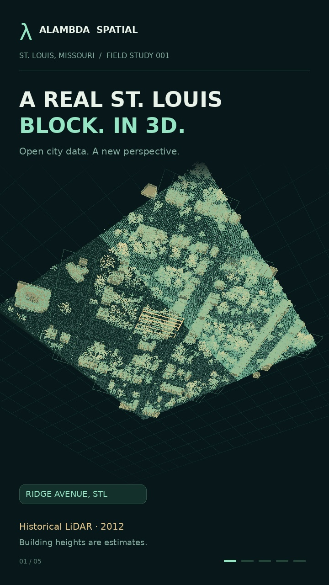

# Alambda Spatial — Ridge Avenue

A browser-based 3D explorer for a 400 × 400 m study window centered at longitude -90.27195, latitude 38.66410 in St. Louis, Missouri.

[Open the live demo](https://alambda-spatial-stl.alambdasystems.chatgpt.site) · [Alambda Systems on GitHub](https://github.com/Alambdasystem)



## Included data

- 264 City of St. Louis parcel polygons and selected assessor fields, retrieved November 13, 2026.
- 150 city building footprints and nearby street centerlines.
- 200,000 actual USGS laser returns, sampled from 458,633 measured returns from January 29–February 1, 2012.
- A 41 × 41 terrain grid based on classified ground returns.
- Point-derived height estimates for 130 buildings; insufficient cases use a clearly labeled 7 m fallback.

The city geometry extends slightly beyond the LiDAR window. Capture and city-record dates differ. This is a historical-data prototype, not a live digital twin or an ownership/availability registry. Building envelopes have flat tops and are not reconstructed roofs. Heights can include tree returns. Parcel and distance information is not a boundary survey.

## Features

Orbit, pan, zoom, top view, animated orbit, address search within the loaded area, clickable parcels and building envelopes, parcel inspector, approximate ground-plan distance measurement, layer switches, and selected-parcel GeoJSON export. The mobile layout uses an address drawer and a property card that leaves the selected location visible.

All assets and scene data are bundled. A WebGL/Three.js renderer displays 200,000 points. Devices without WebGL use a Canvas projection fallback displaying 40,000 of those original points with the same camera, geometry, controls, and raycast selection.

## Get the source

Download [the complete source bundle](alambda-spatial-stl-source.zip), extract it, then run the command below. The bundle includes the app, bundled point data, provenance, scripts, and screenshots.

## Run

Serve `dist/` using any static HTTP server. The app has no account, API-key, runtime service, or CDN dependency. Do not open index.html directly as a file because browser module/fetch rules require HTTP.

```sh
python -m http.server --directory dist 8080
```

The native Sites preview uses `sites-preview start /absolute/path/to/checkout` in its managed environment.

## Data reproduction

Use a Python virtual environment and install `requirements.txt`. Then run:

```sh
python scripts/fetch-city.py
python scripts/extract.py
python scripts/derive.py
```

`extract.py` downloads required USGS EPT hierarchy nodes to ignored `.cache/lidar/`, converts EPSG:3857 XY to a local small-area meter frame, clips to the study window, and deterministically samples actual returns. `derive.py` derives ground and approximate building heights and copies the resulting data into `dist/data/`. For a new data retrieval, update the displayed retrieval dates and regenerate `provenance.json` to match the new snapshot before publishing.

## Sources and licensing

Exact query URLs, retrieval timestamps, scan dates, datum, format, and limitations are in `dist/data/provenance.json` and `metadata.json`.

- City parcels: https://maps8.stlouis-mo.gov/arcgis/rest/services/ASSESSOR/Assessor_Public_Parcels/MapServer/11
- City building footprints: https://maps8.stlouis-mo.gov/arcgis/rest/services/ASSESSOR/Assessor_Public_Parcels/MapServer/9
- USGS EPT: https://usgs-lidar-public.s3.amazonaws.com/MO_StLouis_2012/ept.json
- USGS acquisition metadata: https://prd-tnm.s3.amazonaws.com/StagedProducts/Elevation/LPC/Projects/legacy/MO_STLOUIS_2012/metadata/USGS_LPC_MO_STLOUIS_2012_000042.xml
- Three.js 0.170.0 and OrbitControls: MIT license included in `dist/vendor/THREE-LICENSE.txt`.

2017 LiDAR was located but its LAZ download was unavailable during this build. No 2017 points are shown. No third-party calibration or automated roof reconstruction system is claimed.
